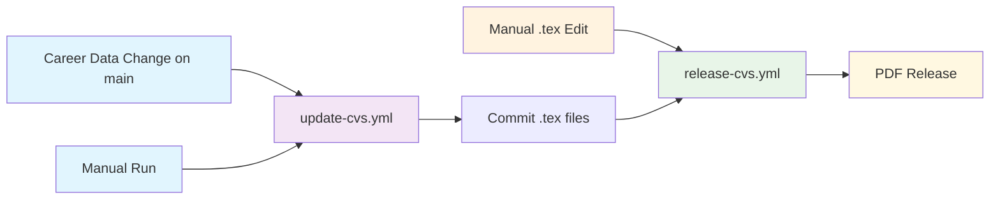

[](https://github.com/SchulteDev/SchulteDev/actions/workflows/update-cvs.yml)
[](https://github.com/SchulteDev/SchulteDev/actions/workflows/release-cvs.yml)
[](https://sonarcloud.io/summary/new_code?id=SchulteDev_SchulteDev%3Acurriculum_vitae_scripts)

# Markus Schulte (Schulte development) CV Generation

AI-powered CV generation using Claude to transform career data into LuaLaTeX documents.

## Overview

Automated system that converts career data from [_data/career.md](../_data/career.md)
into CVs using Claude AI, with GitHub Actions for generation and PDF compilation.

## Architecture

### Two-Workflow System



- [update-cvs.yml](../.github/workflows/update-cvs.yml): tests on every script change; regenerates the CVs
  with Claude on a manual run or a change of `_data/career.md` on `main` → .tex commits
- [release-cvs.yml](../.github/workflows/release-cvs.yml): PDF compilation → GitHub release

Each run regenerates the CVs from the complete career data.

### CV Types

- **professional**: Traditional business format with quantified impact
- **anti**: Humorous format highlighting failures and lessons

### Scripts

| File                                     | Purpose                                                 |
|------------------------------------------|---------------------------------------------------------|
| [cv-update.ts](scripts/cv-update.ts)     | Entry point: career data → prompt → Claude → .tex file  |
| [prompts.ts](scripts/prompts.ts)         | The prompt, incl. page layout and per-CV-type style     |
| [claude.ts](scripts/claude.ts)           | Claude API request and response checks                  |
| [latex.ts](scripts/latex.ts)             | Cuts the LaTeX document out of the response             |
| [config.ts](scripts/config.ts)           | Settings from the environment or a local `.env` file    |

## Local Usage

```bash
npm test
npm run test:coverage
npm run typecheck
SKIP_API=true npm run cv:update   # End-to-end run re-using the committed CVs, no API call
CV_TYPES=anti npm run cv:update   # Regenerate only the anti CV with Claude
```

## Environment

**Required**: `ANTHROPIC_API_KEY` (unless `SKIP_API=true`)  
**Optional**: `CV_TYPES` (default `professional,anti`), `SKIP_API`, `CAREER_FILE`  
**Model**: `API_MODEL` (default `claude-sonnet-5-5`; the workflow also offers `claude-opus-5-5`),
`API_EFFORT` (adaptive-thinking effort `low`–`max`, default `xhigh`), `MAX_TOKENS` (default `64000`)

The Claude response of each run is written to `scripts/tmp/claude-response-<type>.json`.
